# MEG Preprocessing Pipeline Documentation

## Overview

This MEG preprocessing pipeline processes the raw magnetoencephalography (MEG) data for the localizer task of PI Marcelo Mattar and Dr. Jonathan Nicholas's Four-in-a-Row project, and made my Research Assistant Dariush Nashat.  The pipeline is implemented in Python using the MNE library and includes a Signal-to-Noise Ratio (SNR) analysis at each stage to measure the sequential improvement of the signal quality.

**Main Script:** `preprocessing_meg.py`  
**SNR Tracking Module:** `snr_both.py`

### Pipeline Architecture

The preprocessing pipeline consists of six main steps:
1. **Raw data loading and baseline SNR calculation**
2. **Frequency filtering (1-40 Hz)**
3. **Bad channel detection and interpolation**
4. **Radio noise removal (only in special cases, not shown here)**
5. **Empty room projection (environmental noise removal)**
6. **Independent Component Analysis (ICA) for artifact removal**

After preprocessing, the pipeline performs epoching to segment the continuous data into onset and response epochs for future classification and analysis. 

---

## Configuration

Before running the pipeline, make note of the following parameters in `preprocessing_meg.py`:

**[Lines 25-32](scripts/preprocessing_meg.py#L25-L32)**

```python
subj = 'R2611'  # Subject ID
dtypes = ['localizer']  # Data type: 'localizer' or 'main'
epoching_types = ['localizer']  # Data type: 'localizer' or 'main'
base_dir = f'/Users/dariushnashat/Documents/Mattar Lab Internship/' 
data_dir = os.path.join(base_dir, subj)
empty_room_file = f'{data_dir}/raw/{subj}_EmptyRoom_nr.sqd'
overwrite = True
epochsonly = False
```

Importantly, you will need to have the following directory structure: At the location of base_dir, you will need a folder titled the Subject ID (in this case 'R2611'). In that folder you will need one folder titled 'raw', one folder titled 'preprocessing', and the subject's logfile in the format of 'R2611_logfile.csv'. In the 'raw' folder, you will need to have localizer '.fif.' files that you have already created with the mne toolkit GUI. The 'preprocessing' folder can be empty, as it is where the script will place the preprocessed data along the way. 


### Epoch Configurations

**[Lines 34-55](scripts/preprocessing_meg.py#L34-L55)**

The pipeline supports different epoching configurations for different task types:

**Localizer Task:**
- Event IDs: 161 (onset), 164 (offset)
- Onset window: -100ms to 1000ms (baseline: -100ms to 0ms)
- Response window: -1000ms to 100ms (baseline: -1000ms to -900ms)
- Rejection criteria: mag=4e-12, grad=4e-12
- Flat criteria: mag=1e-15, grad=1e-13

```python
epoch_configs = {
    'localizer': {
        "event_ids": {'161': 161, '164': 164},
        "tmin_161": -0.1, "tmax_161": 1.0, "baseline_161": (-0.1, 0),
        "tmin_164": -1.0, "tmax_164": 0.1, "baseline_164": (-1.0, -0.9),
        "decim": 1,
        "expected_nb_events": 1008,
        "photodiode_realignment": True,
        "reject_criteria": dict(mag=4e-12, grad=4e-12),
        "flat_criteria": dict(mag=1e-15, grad=1e-13)
    }
}
```

---

## Pipeline Execution: Step-by-Step

### STEP 1: Loading Raw Data and Baseline SNR Calculation

**Code Reference:** [`preprocessing_meg.py` Lines 84-107](scripts/preprocessing_meg.py#L84-L107)

The pipeline begins by loading the raw MEG data files created from the mne-toolkit GUI. 

```python
# Load raw .fif files
raws = []
for file in sorted(glob.glob(f'{data_dir}/raw/*{dtype}*.fif')):
    print(f'  Loading {os.path.basename(file)}')
    raws.append(mne.io.read_raw_fif(file, preload=True))

raw = mne.concatenate_raws(raws)
```

The pipeline then creates temporary epochs and calculates SNR for both onset (stimulus-based) and response (response-based) time windows. It will soon be explained how the SNR is actually calculated in `snr_both.py`:

```python
temp_epochs_onset = create_temp_epochs_onset(raw)
snr_onset_global, snr_onset_raw, _ = calculate_snr_onset(temp_epochs_onset)

temp_epochs_response = create_temp_epochs_response(raw)
snr_response_global, snr_response_raw, _ = calculate_snr_response(temp_epochs_response)
```

**Example Output (Subject R2611):**

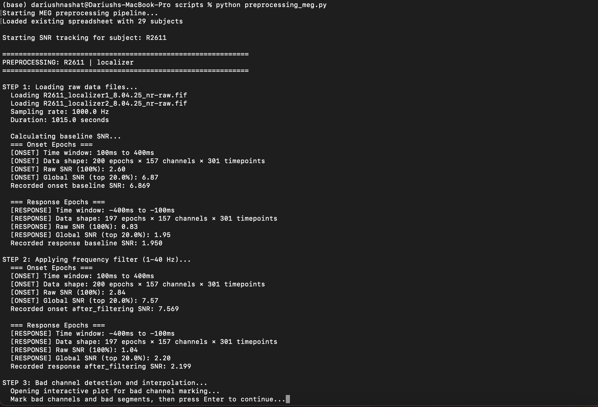

As shown in the terminal output above:
- Loaded data from 2 raw files for subject R2611
- Sampling rate: 1000.0 Hz
- Total duration: 1015.0 seconds
- **Baseline Onset SNR:** Raw SNR (100%): 2.60, Global SNR (top 20.0%): 6.87
- **Baseline Response SNR:** Raw SNR (100%): 0.83, Global SNR (top 20.0%): 1.95

### STEP 2: Frequency Filtering

**Code Reference:** [`preprocessing_meg.py` Lines 110-123](scripts/preprocessing_meg.py#L110-L123)

As you can see, the first edit to the data comes from applying a bandpass filter is to remove frequencies outside a safe range of interest (1-40 Hz), which helps eliminate slow drifts and high-frequency noise (generally from movement artifactts). 

```python
raw.filter(1, 40, method='iir')
```

And the SNR is recalculated for both onset and response epochs.

The raw data is then displayed in an interactive plot for initial inspection and the removal of bad channels:

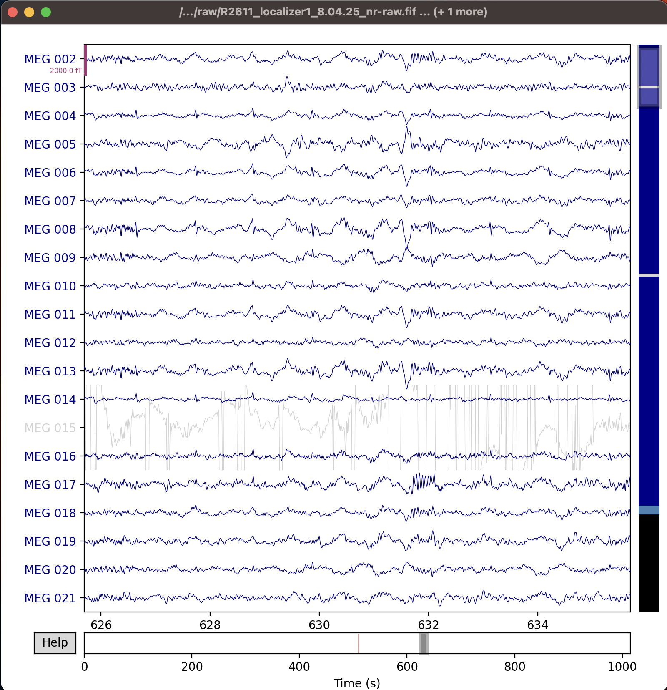
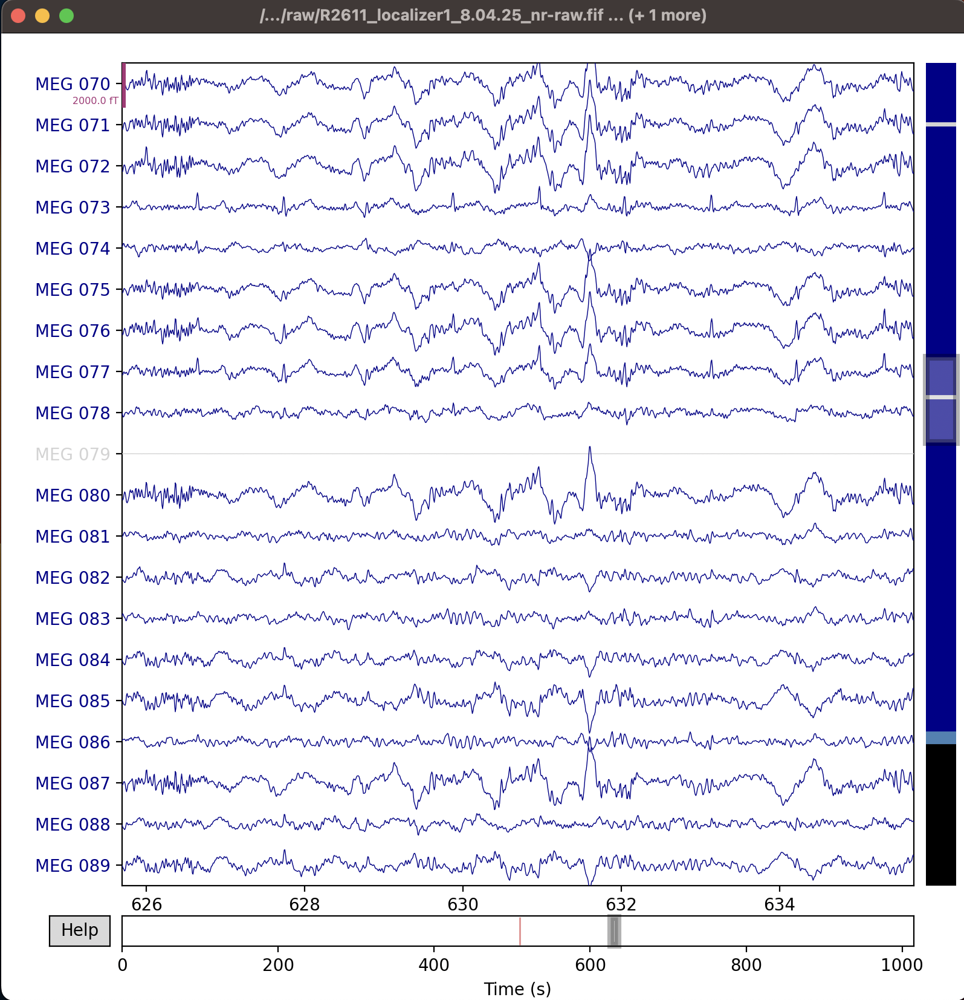

---

## Understanding SNR Calculation

Now that you can get a sense for the visualization of the data, it is a good time to review how the Signal-to-Noise Ratio is calculated throughout the pipeline (and how it was already calculated for the baseline and to measure the effect of the bandpass filtering). The SNR calculation is handled by the `snr_both.py` script.

### This SNR calculation was inspired by [Gonzalez-Moreno et al., 2014](#gonzalez2014).

### SNR Calculation Methodology

**Code Reference:** [`snr_both.py` Lines 250-309](scripts/snr_both.py#L250-L309) (Onset) and [Lines 312-371](scripts/snr_both.py#L312-L371) (Response)

The SNR calculation creates separate analyses for the onset (stimulus-locked) and response (response-locked) epochs:

#### For Onset Epochs (Stimulus-Locked)

**Time Window:** 100-400ms post-stimulus

```python
def calculate_snr_onset(epochs, time_window=(0.1, 0.4), top_percentile=0.2):
    # Extract data within time window
    time_mask = (epochs.times >= time_window[0]) & (epochs.times <= time_window[1])
    data = epochs.get_data()[:, :, time_mask]
    
    # Calculate SNR for each channel-time combination
    for ch in range(n_channels):
        for t in range(n_timepoints):
            signal_mean = np.mean(data[:, ch, t])
            signal_std = np.std(data[:, ch, t], ddof=0)
            standard_error = signal_std / np.sqrt(n_epochs)
            
            if signal_std > 0:
                snr = abs(signal_mean) / standard_error
```

#### For Response Epochs (Response-Locked)

**Time Window:** -400ms to -100ms pre-response

```python
def calculate_snr_response(epochs, time_window=(-0.4, -0.1), top_percentile=0.2):
    # Same calculation as onset, but with response-locked timing
```

### Key SNR Metrics

The pipeline calculates two SNR values at each stage. Both SNRs are basically done by taking each combination of an MEG (working) channel and a timepoint of interest (300 timepoints, each for a ms from 0.1-0.4 seconds after the onset or before the offset), assign an SNR value. Because there were 200 onset events, there are 200 signal amplitudes per channel/timepoint pair. The script then calculates the average, standard deviation, and standard errors of the amplitudes in each channel/timepoint pair across the 200 epochs. Finally, it calculates an SNR for each channel/timepoint pair, which is defined as `snr = abs(signal_mean) / standard_error`. 

1. **Raw SNR (100%):** The mean SNR across all channel-timepoint combinations
   
   **[Line 299](snr_both.py#L299)**
   ```python
   raw_snr = np.mean(flat_snrs)
   ```

2. **Global SNR (top 20%):** The mean of the top 20% of SNR values, providing a more robust estimate focused on the strongest signals
   
   **[Lines 302-304](scripts/snr_both.py#L302-L304)**
   ```python
   threshold_idx = int((1 - top_percentile) * len(flat_snrs))
   top_snrs = np.partition(flat_snrs, threshold_idx)[threshold_idx:]
   global_snr = np.mean(top_snrs)
   ```

### SNR Tracking System

**Code Reference:** [`snr_both.py` Lines 12-66](scripts/snr_both.py#L12-L66)

The `SNRTracker` class maintains a comprehensive record of SNR improvements throughout preprocessing:

```python
class SNRTracker:
    def __init__(self, base_dir):
        self.spreadsheet_path = os.path.join(base_dir, 'snr_analysis_master.csv')
        # Tracks SNR at each stage: baseline, after_filtering, after_interpolation,
        # after_radio_noise, after_empty_room, after_ica
```

For each preprocessing stage, the tracker records:
- Absolute SNR values for both onset and response epochs **[Lines 21-37](scripts/snr_both.py#L21-L37)**
- Delta SNR (change from previous stage) **[Lines 38-51](scripts/snr_both.py#L38-L51)**
- Relative contribution to total improvement (percentage) **[Lines 52-63](scripts/snr_both.py#L52-L63)**

### Temporary Epochs Creation

**Code Reference:** 
- Onset epochs: [`snr_both.py` Lines 374-405](scripts/snr_both.py#L374-L405)
- Response epochs: [`snr_both.py` Lines 408-439](scripts/snr_both.py#L408-L439)

At each preprocessing stage, temporary epochs are created specifically for SNR calculation:

```python
def create_temp_epochs_onset(raw):
    events = mne.find_events(raw, min_duration=0.0025)
    events[:, 0] += 60  # Photodiode realignment
    events_filtered = events[events[:, 2] == 161]
    temp_epochs = mne.Epochs(
        raw, events_filtered,
        event_id={'161': 161},
        tmin=-0.1, tmax=1.0,
        baseline=(-0.1, 0),
        picks=picks_meg,
        preload=True, 
        reject=None  # No rejection during SNR calculation
    )
    return temp_epochs
```


**As you will notice throughout this documentation, the Signal-to-Noise Ratio is calculated and displayed at each preprocessing step to emphasize the sequential improvement in data quality.**

---

### STEP 3: Bad Channel Detection and Interpolation

**Code Reference:** [`preprocessing_meg.py` Lines 125-154](scripts/preprocessing_meg.py#L125-L154)

These plots show the continuous MEG recordings across all channels. You can and should use the arrow keys to move across all channels and timepoints for thorough inspection. As you can see, channels 015 and 079 have been removed (they are greyed out). Channel 015 is far too noisy (at a later timepoint) while Channel 079 is far too flat. 

**User Instructions:**
- Click on channel names to mark them as bad
- Close the tab of the continuous data
- Press Enter in the terminal when finished

**Example Output:**

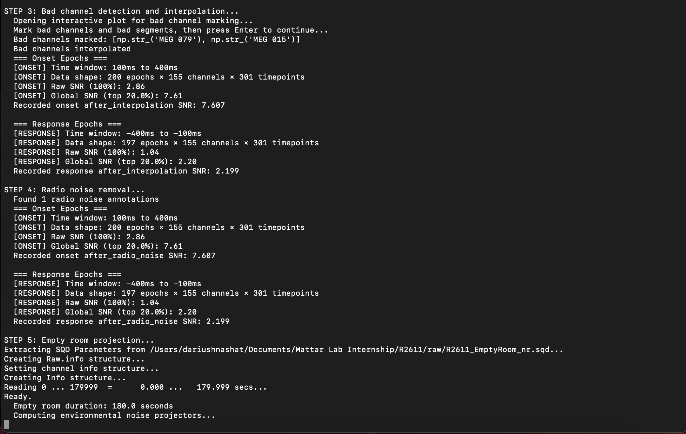


### STEP 4: Radio Noise Removal

For now, we will skip this step as it does not occur enough to include in the preprocessing pipeline for standard scans. In this example, there was no radio noise so nothing was done for this step, and you will notice that the SNR remains unchanged from this step. 

### STEP 5: Empty Room Projection

**Code Reference:** [`preprocessing_meg.py` Lines 222-270](scripts/preprocessing_meg.py#L222-L270)

Environmental noise is characterized using an empty room recording (no subject present) and removed from the data using signal space projection (SSP).

```python
# Load empty room recording
empty_room_raw = mne.io.read_raw_kit(empty_room_file, preload=True)
empty_room_raw.filter(1, 40, method='iir')

# Compute noise projectors
empty_room_projs = mne.compute_proj_raw(
    empty_room_raw, 
    duration=2,
    n_grad=0,
    n_mag=0.9,
    reject={'mag': 3e-12},
    flat={'mag': 1e-15}
)

# Apply to main data
raw.add_proj(empty_room_projs, remove_existing=False)
raw.apply_proj()
```

**Process:**
1. Load empty room recording (180 seconds for R2611)
2. Apply same filtering as main data (1-40 Hz)
3. Remove same bad channels already found
4. Extract principal components representing environmental noise patterns
5. Project these patterns out of the main data

**Example Output:**

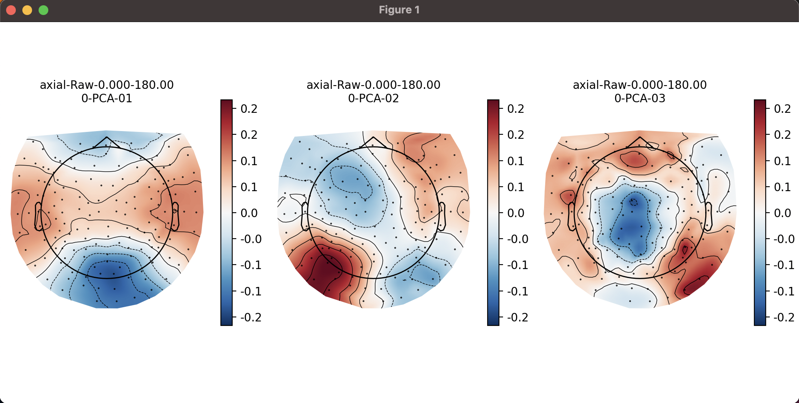

The pipeline creates 3 PCA-based noise projectors from the empty room data:


These topographies show the spatial patterns of environmental noise picked up by the empty room projection. Once you close the tab of these topographies, the script can continue. 

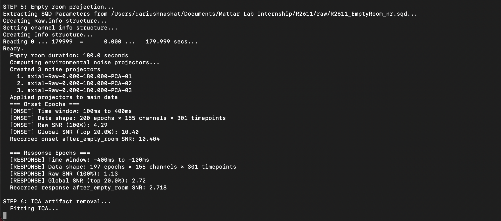

---

### STEP 6: ICA Artifact Removal

**Code Reference:** [`preprocessing_meg.py` Lines 272-308](scripts/preprocessing_meg.py#L272-L308)

Independent Component Analysis (ICA) decomposes the data into statistically independent components, allowing identification and removal of artifacts such as eye blinks, heartbeats, and muscle activity.

```python
# Fit ICA
ica = mne.preprocessing.ICA(n_components=0.95, method='fastica')
ica.fit(raw, reject={'mag': 5e-12})

# Interactive component selection
ica.plot_sources(raw)  # Time courses
ica.plot_components()  # Topographies

# Apply ICA
raw = ica.apply(raw)
```

**Process:**
1. Fit ICA with 95% variance explained (automatic component number selection)
2. Review component time courses to identify artifacts
3. Review component topographies to confirm artifact patterns
4. Mark artifact components for exclusion
5. Apply ICA transformation to remove artifacts

**Example Output:**


The user is prompted to review ICA components:

**ICA Component Time Courses:**

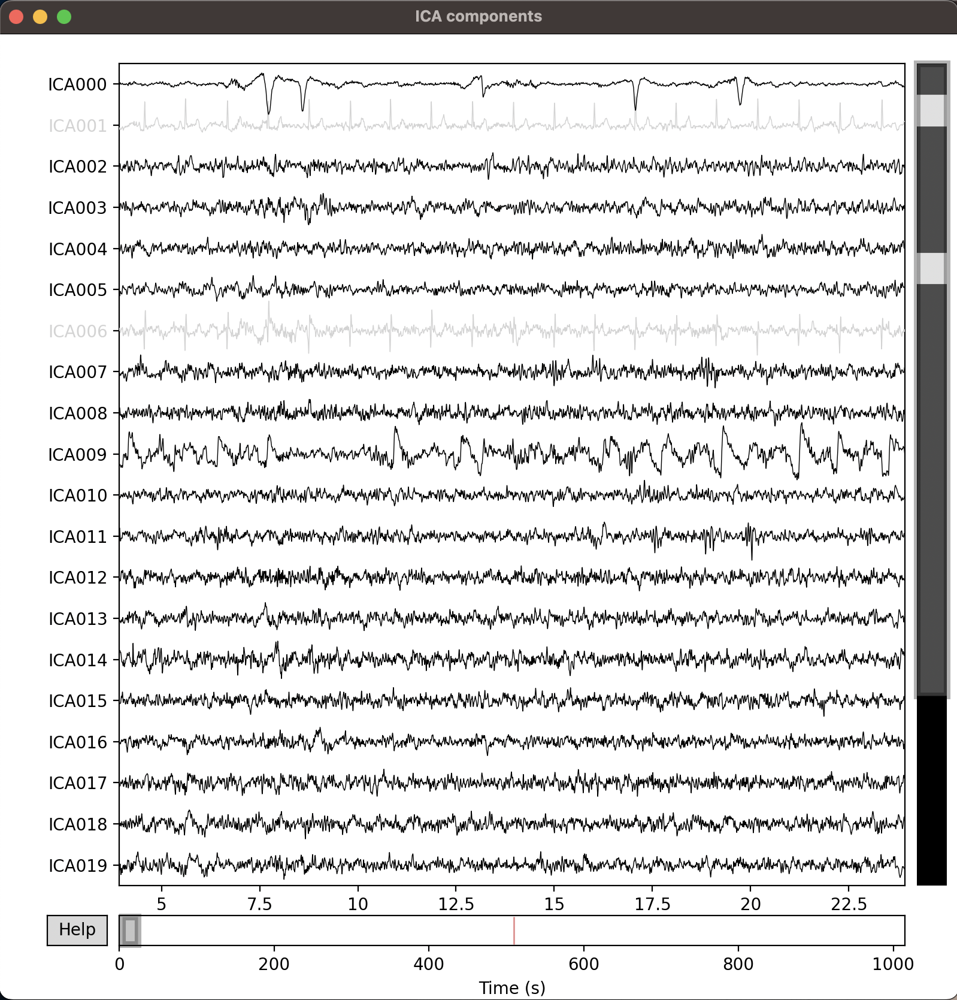

**More ICA Components:**

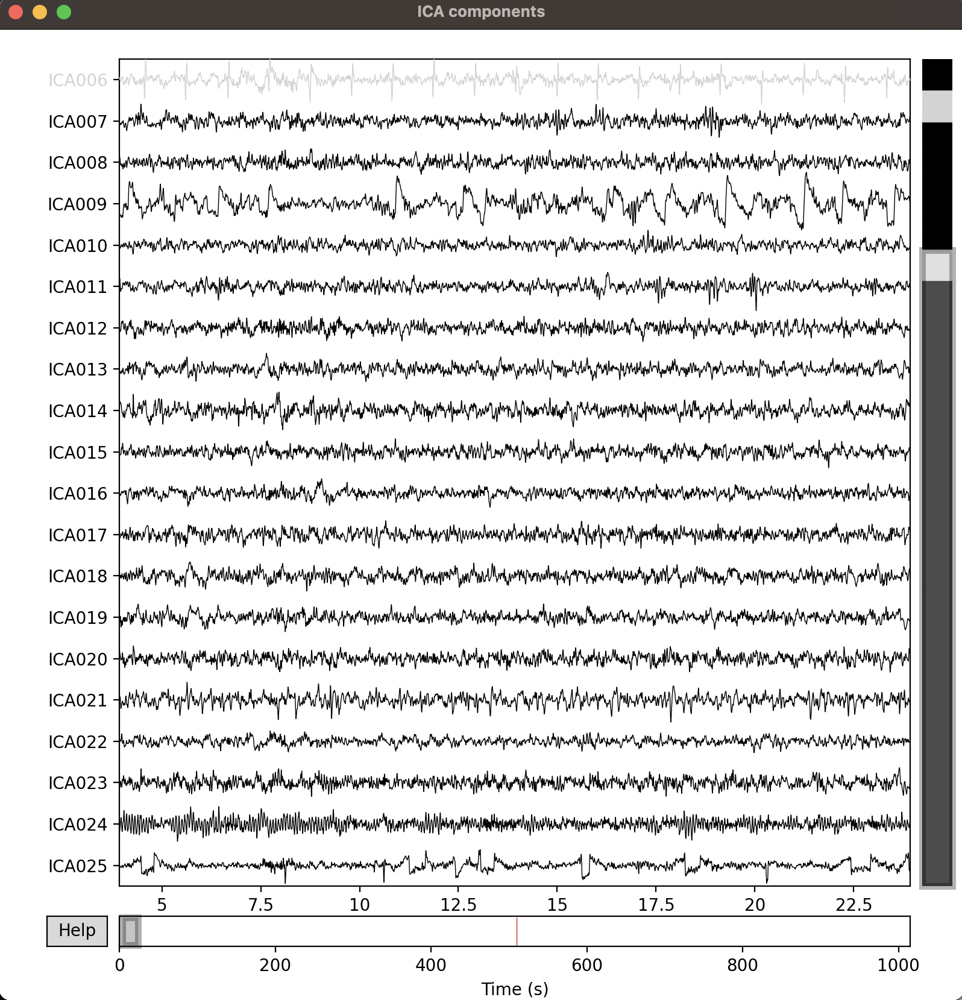

**ICA Component Topographies:**

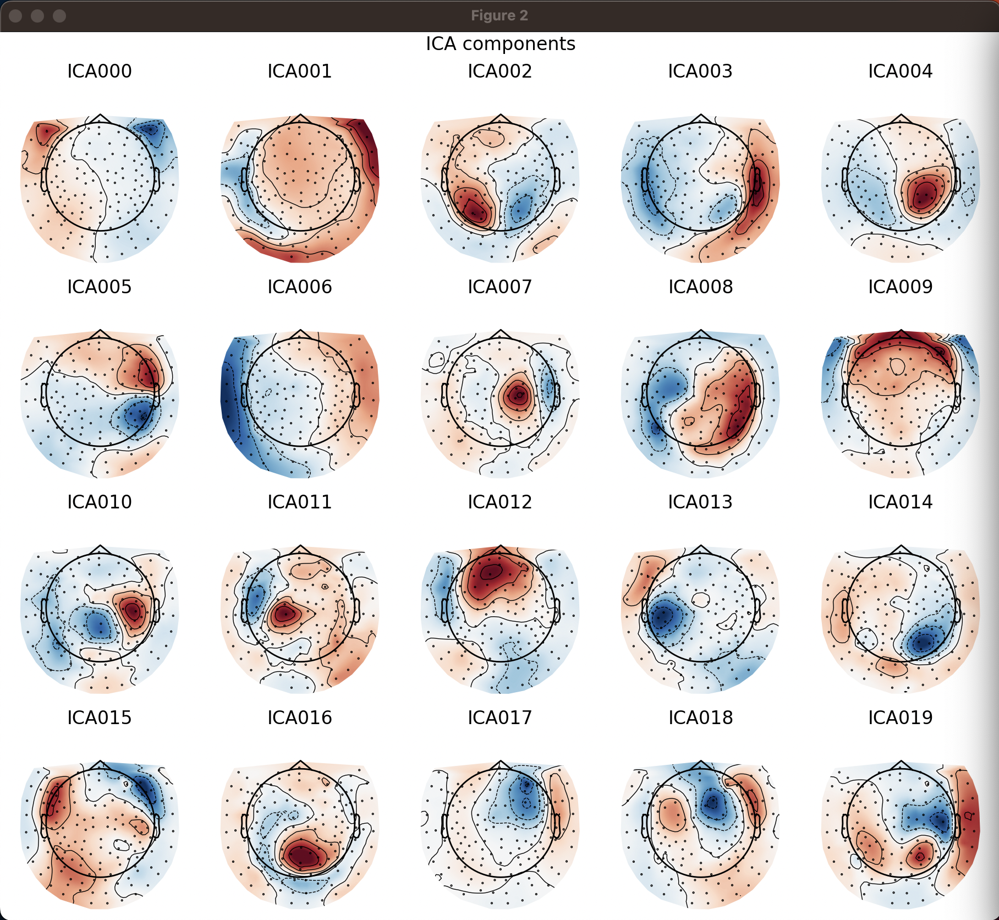


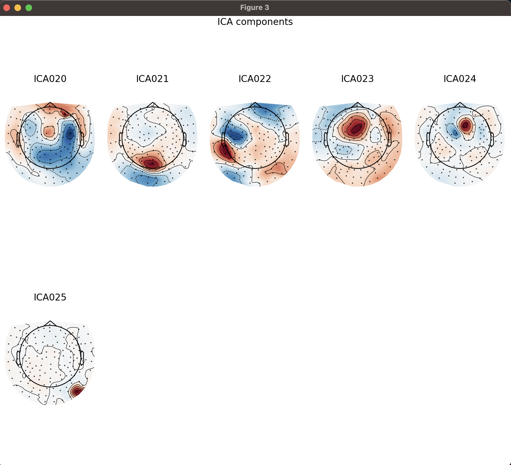

For subject R2611, components **[1, 6]** were marked for exclusion. These components are cardiovascular artifacts, which you can identify by the heart-beat-like frequency of their plotted recordings. 

### Important Note: 
Most EEG/MEG preprocessing literature states that we should also remove ocular artifacts (eyeblinks and saccades), which you can best identify from artifacts where the topographies that show activities around the frequency plots show sharp, inconsistent spikes. However, we used this SNR analysis to measure the effect of removing cardiovascular and ocular artifacts. On average and quite consistently across our participants, removing cardiovascular artifacts increased the SNR, while removing the ocular artifacts decreased the SNR. This makes sense given that we are running a visual task, and certain ocular behavior might actually be relevant to the overall signal quality within the onset and offset epochs. 


**Terminal Output After ICA:**
Once you have selected the artifacts to remove, close the tabs and press enter in following Terminal stream:

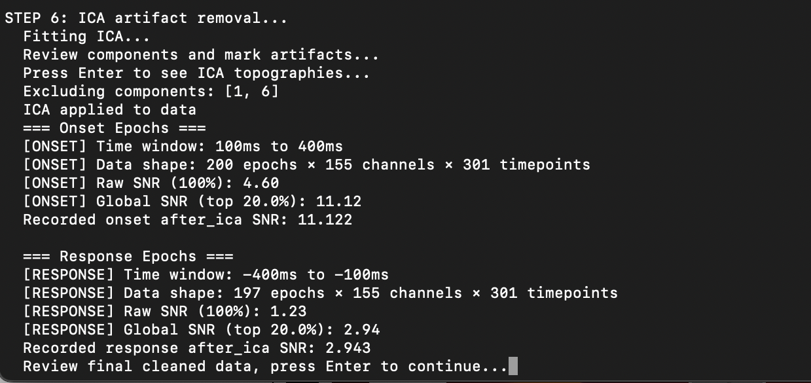

**Final Data Review:**
This will generate the following plot of the raw continuous, cleaned data:

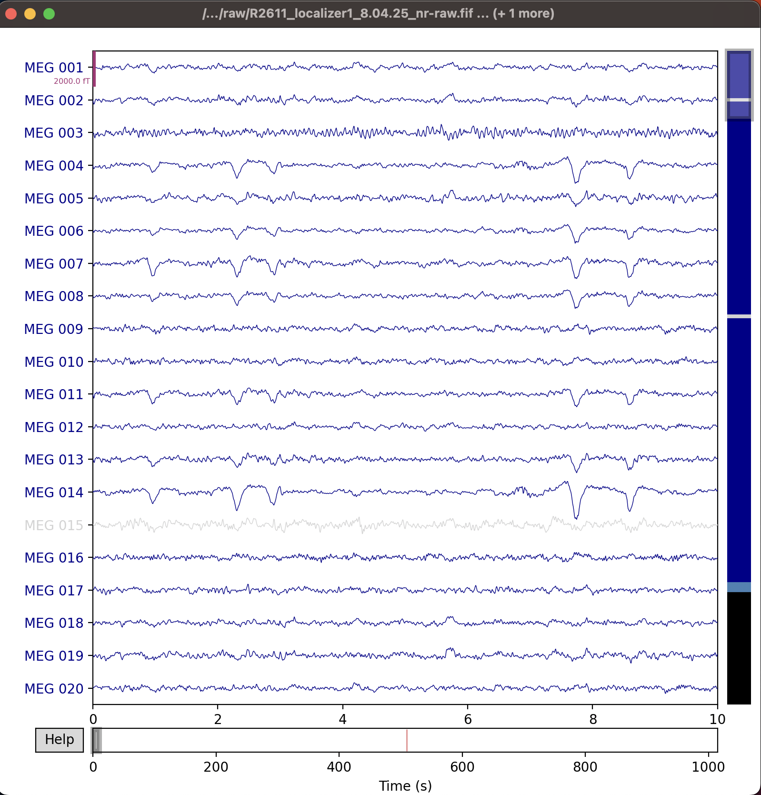

The cleaned data is displayed for final inspection. Note the smoother signals and reduced artifacts compared to the raw data shown in Step 1. Channel MEG 015 remains grayed out as a record of interpolation.

---

## Final SNR Summary

**Code Reference:** [`preprocessing_meg.py` Lines 313-319](scripts/preprocessing_meg.py#L313-L319) (Save), [`snr_both.py` Lines 182-215](scripts/snr_both.py#L182-L215) (Calculate)

After all preprocessing steps are complete, the pipeline calculates and displays the cumulative improvements:

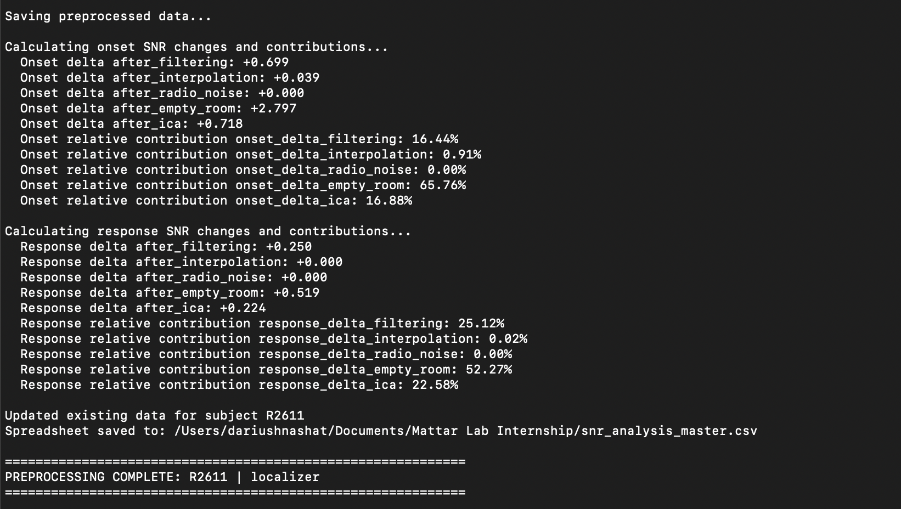

---

## Epoching Process

**Code Reference:** [`preprocessing_meg.py` Lines 326-578](scripts/preprocessing_meg.py#L326-L578)

After preprocessing, the continuous data is segmented into epochs for trial-based analysis.

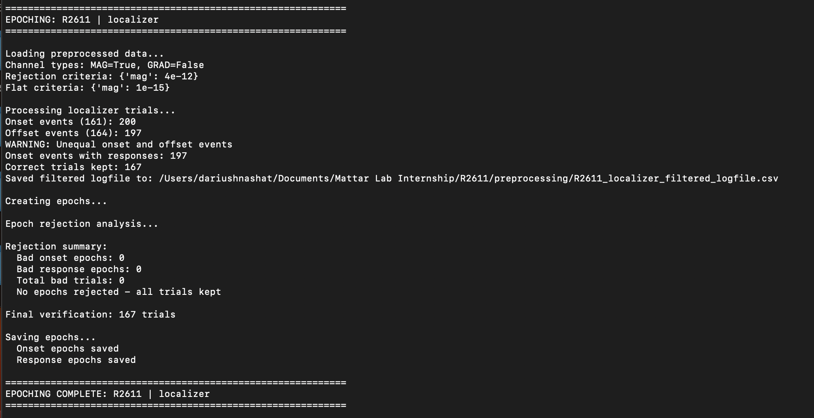

### Process Steps

1. **Load preprocessed data** ([Lines 346-350](scripts/preprocessing_meg.py#L346-L350))
   ```python
   raw = mne.io.read_raw_fif(raw_path, preload=True)
   events = mne.find_events(raw, min_duration=0.0025)
   ```

2. **Photodiode realignment** ([Lines 370-372](scripts/preprocessing_meg.py#L370-L372))
   ```python
   if configs["photodiode_realignment"]:
       events[:, 0] += 60  # 60ms delay compensation
   ```

3. **Load behavioral logfile** ([Line 375](scripts/preprocessing_meg.py#L375))
   ```python
   logfile = pd.read_csv(f'{data_dir}/{subj}_logfile.csv')
   ```

4. **Filter events** ([Lines 380-420](scripts/preprocessing_meg.py#L380-L420))
   - For localizer: separate onset (161) and offset (164) events
   - Keep only trials with responses
   - Keep only correct trials (accuracy = True)

   ```python
   events_161 = events[events[:, 2] == 161]  # Onset events
   events_164 = events[events[:, 2] == 164]  # Offset events
   ```

5. **Create epochs with rejection criteria** ([Lines 429-454](scripts/preprocessing_meg.py#L429-L454))
   ```python
   epochs_onset = mne.Epochs(
       raw, filtered_events_161, 
       event_id={'161': 161},
       tmin=-0.1, tmax=1.0,
       baseline=(-0.1, 0),
       reject=dict(mag=4e-12, grad=4e-12),
       flat=dict(mag=1e-15, grad=1e-13)
   )
   ```

6. **Epoch rejection analysis** ([Lines 456-533](scripts/preprocessing_meg.py#L456-L533))
   - Identifies epochs exceeding rejection criteria
   - Removes bad trials from both onset and response epochs
   - Ensures equal trial counts across epoch types

7. **Save epochs** ([Lines 551-574](scripts/preprocessing_meg.py#L551-L574))
   - `.fif` format for MNE compatibility
   - `.mat` format for MATLAB analysis
   - Filtered logfile with trial metadata

### Example Output

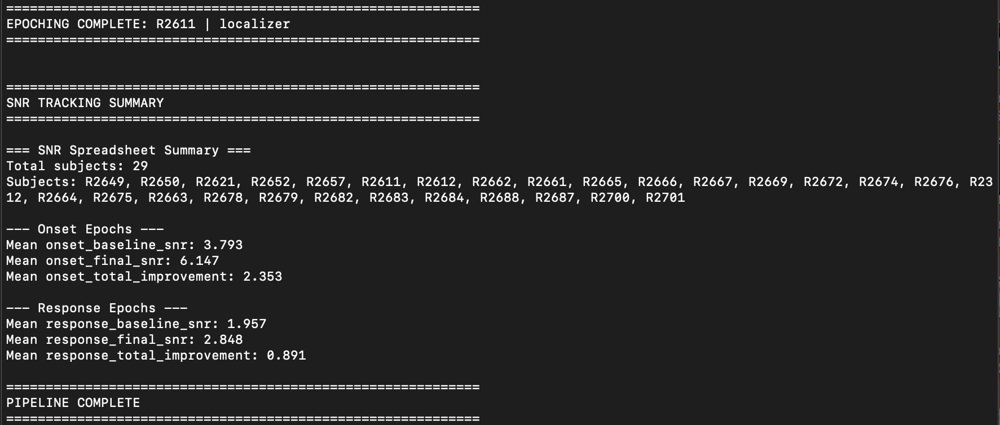

---

## Output Files

The pipeline generates the following files in the `preprocessing/` directory:

### Preprocessing Outputs
- `{subj}_{dtype}_ICA-raw.fif` - Fully preprocessed continuous data
- `{subj}_{dtype}_icasolution-ica.fif` - ICA solution
- `{subj}_{dtype}-info.p` - Recording info (pickle)
- `{subj}_{dtype}_ica_exclude.p` - Excluded ICA components (pickle)

### Epoching Outputs
- `{subj}_{dtype}_onset-epo.fif` - Onset epochs
- `{subj}_{dtype}_offset-epo.fif` - Response epochs
- `{subj}_{dtype}.mat` - Epochs in MATLAB format
- `{subj}_{dtype}_filtered_logfile.csv` - Trial metadata
- `{subj}_{dtype}_rejection_report.p` - Epoch rejection details

### SNR Tracking
- `snr_analysis_master.csv` - Comprehensive SNR tracking across all subjects

---

## Systematic SNR Visualization

Below are visualizations of the SNR change throughout this pipeline for the data of 27 of our participants, for both onset epochs and response epochs:

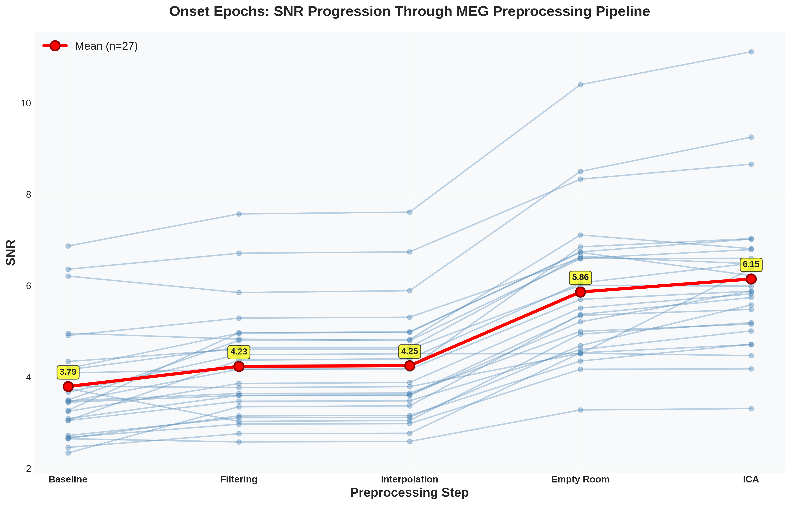

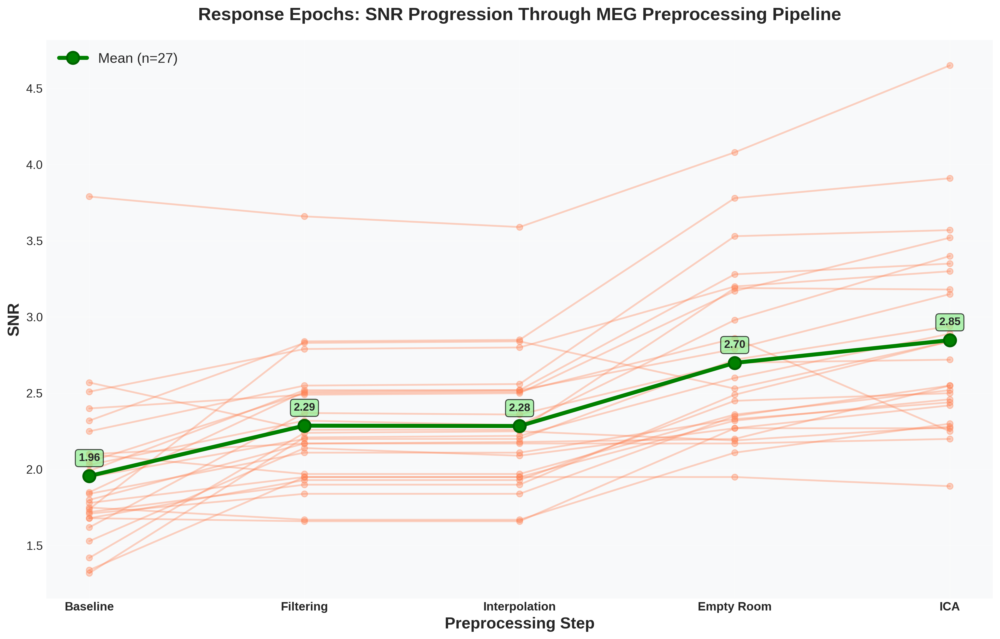

---

## References

- <a id="gonzalez2014"></a>Gonzalez-Moreno, A., Aurtenetxe, S., Lopez-Garcia, M.E., del Pozo, F., Maestu, F., & Nevado, A. (2014). [Signal-to-noise ratio of the MEG signal after preprocessing](https://www.sciencedirect.com/science/article/abs/pii/S0165027013003713). *Journal of Neuroscience Methods*, 235, 78-87.